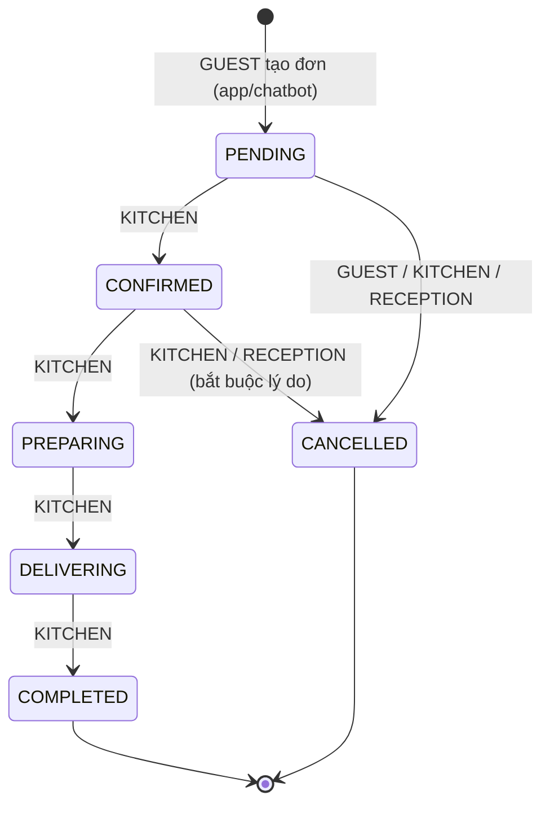
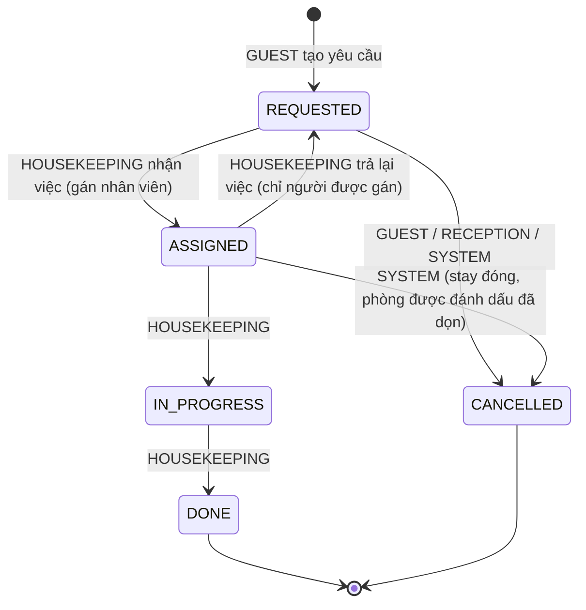
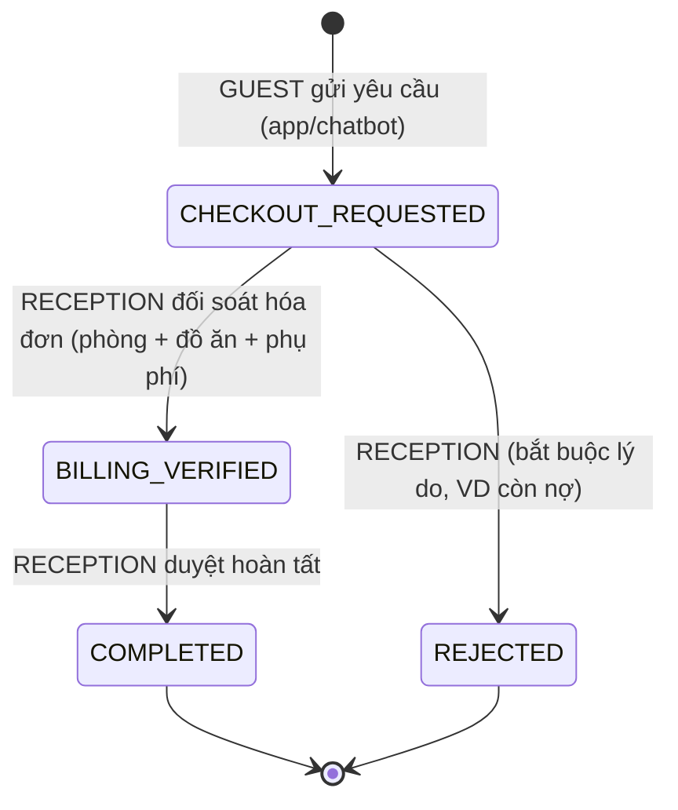

# Domain Rules — Quy tắc nghiệp vụ

Nguồn sự thật cho trạng thái, quyền chuyển trạng thái và thông báo. Backend enforce toàn bộ; frontend chỉ phản ánh.
Chuyển trạng thái không hợp lệ → `409 Conflict`. Sai vai trò → `403 Forbidden`.

---

## 1. Thực thể chính

| Thực thể | Ghi chú |
|---|---|
| `room` | Phòng vật lý. Trạng thái: `VACANT` → `OCCUPIED` → `CLEANING` → `VACANT`. |
| `stay` | Một kỳ lưu trú gắn với `room`. Giữ `room_code_hash`, `checkin_at`, `expected_checkout_at`, `status` (`ACTIVE`, `CHECKOUT_PENDING`, `CLOSED`). |
| `stay_session` | Phiên đăng nhập của thiết bị khách: `jti`, `stay_id`, `fcm_token`, `revoked_at`. |
| `food_order` / `order_item` | Đơn đồ ăn, giá chốt tại thời điểm đặt. |
| `housekeeping_request` | Yêu cầu dọn phòng / thêm đồ dùng (`type`: `CLEANING`, `AMENITY`). |
| `checkout_request` | Yêu cầu trả phòng nhanh. |
| `status_history` | Lịch sử chuyển trạng thái (ai, khi nào, từ → đến, lý do) cho mọi yêu cầu. |

## 2. Vòng đời mã phòng & phiên lưu trú

```mermaid
stateDiagram-v2
    [*] --> VACANT
    VACANT --> OCCUPIED: RECEPTION check-in\n(sinh mã phiên/QR, tạo stay ACTIVE)
    OCCUPIED --> OCCUPIED: Khách đổi mã → stay_session_token
    OCCUPIED --> CLEANING: RECEPTION check-out / duyệt Express Checkout\n(revoke mọi stay_session)
    CLEANING --> VACANT: HOUSEKEEPING hoàn tất việc TURNOVER
(hoặc RECEPTION "Đánh dấu đã dọn")
```

- Mã phiên dùng được khi `stay.status` là `ACTIVE` hoặc `CHECKOUT_PENDING` (lúc chờ trả phòng chỉ xem, không tạo yêu cầu mới), tới `expected_checkout_at` + 6 giờ. Nhiều thiết bị cùng stay được phép (mỗi thiết bị một `jti`, tối đa 6).
- Lễ tân có thể **cấp lại mã** (revoke mã cũ + mọi session cũ) khi nghi lộ.
- Khi stay `CLOSED`: mọi token → `401`; đơn đồ ăn `PENDING`/`CONFIRMED` và yêu cầu buồng phòng `REQUESTED`/`ASSIGNED` chuyển `CANCELLED` (lý do `STAY_CLOSED`); đơn đang nấu/giao và việc dọn đang làm được giữ nguyên; hệ thống mở một việc `TURNOVER` cho phòng.
- Lễ tân "Đánh dấu đã dọn" (`CLEANING → VACANT`) thì việc `TURNOVER` chưa bắt đầu của phòng bị hủy (lý do `MARKED_VACANT_BY_RECEPTION`).

## 3. Đặt đồ ăn (Room Service)



| Chuyển | GUEST | KITCHEN | RECEPTION | HOUSEKEEPING |
|---|:-:|:-:|:-:|:-:|
| tạo → `PENDING` | ✅ | | | |
| `PENDING → CONFIRMED` | | ✅ | | |
| `PENDING → CANCELLED` | ✅ | ✅ | ✅ | |
| `CONFIRMED → PREPARING → DELIVERING → COMPLETED` | | ✅ | | |
| `CONFIRMED → CANCELLED` | | ✅ | ✅ | |

- Khách chỉ được hủy khi đơn còn `PENDING`.
- Món phải `available = true` lúc tạo đơn; tổng tiền do backend tính từ giá trong DB.
- Đơn `PENDING` quá 10 phút chưa xác nhận → nhắc Lễ tân trên Web.

## 4. Dọn phòng / thêm đồ dùng (Housekeeping)



| Chuyển | GUEST | HOUSEKEEPING | RECEPTION | KITCHEN |
|---|:-:|:-:|:-:|:-:|
| tạo → `REQUESTED` | ✅ | | | |
| `REQUESTED → ASSIGNED → IN_PROGRESS → DONE` | | ✅ | | |
| `ASSIGNED → REQUESTED` (trả lại việc) | | ✅ | | |
| `REQUESTED → CANCELLED` | ✅ | | ✅ | |

- Khách có thể chọn khung giờ mong muốn (`preferred_time`) hoặc "Không làm phiền".
- Một stay chỉ có tối đa 1 yêu cầu `CLEANING` đang mở cùng lúc (tránh spam), tối đa 3 yêu cầu `AMENITY` đang mở.
- Loại yêu cầu: `CLEANING`, `AMENITY` (khách tạo) và `TURNOVER` (hệ thống tạo khi trả phòng, không gắn stay, khách không thấy). Mỗi phòng tối đa 1 `TURNOVER` đang mở; `TURNOVER → DONE` đưa phòng từ `CLEANING` về `VACANT`.
- Chỉ nhân viên được gán mới chuyển `IN_PROGRESS`, `DONE` hoặc trả lại việc.

## 5. Trả phòng nhanh (Express Checkout)



- Khi `COMPLETED`: `stay.status = CLOSED`, **revoke ngay** mọi `stay_session`, phòng → `CLEANING`, tự tạo housekeeping `CLEANING`.
- Khi `CHECKOUT_REQUESTED`: `stay.status = CHECKOUT_PENDING`; khách vẫn xem được trạng thái nhưng không tạo đơn mới.
- Chỉ `RECEPTION` thao tác các bước của Express Checkout.

## 6. Ma trận phân việc tổng hợp

| Nghiệp vụ | Xử lý chính | Giám sát | Khách thấy |
|---|---|---|---|
| Đặt đồ ăn | KITCHEN | RECEPTION (read + hủy) | Trạng thái realtime + FCM |
| Dọn phòng / đồ dùng | HOUSEKEEPING | RECEPTION (read + hủy) | Trạng thái realtime + FCM |
| Express Checkout | RECEPTION | — | Trạng thái realtime + FCM |
| Check-in / cấp mã | RECEPTION | — | — |
| Khiếu nại / hỏi đáp khác | RECEPTION | — | Phản hồi qua app |

## 7. Quy tắc thông báo đẩy (FCM)

- **Mỗi lần trạng thái đổi** (food_order, housekeeping_request, checkout_request) → gửi FCM tới mọi `stay_session`
  còn hiệu lực của stay đó.
- Gửi **sau khi transaction DB commit** (outbox pattern hoặc background task), không trong transaction.
- Payload `data` (không chứa thông tin nhạy cảm, không chứa mã phòng):
  ```json
  { "type": "FOOD_ORDER|HOUSEKEEPING|CHECKOUT", "entity_id": "uuid", "status": "PREPARING",
    "title_key": "order.preparing", "occurred_at": "ISO-8601" }
  ```
- `notification` title/body theo ngôn ngữ của session (`vi`, `en`, …).
- Token FCM không hợp lệ (`UNREGISTERED`) → xóa khỏi session. Retry tối đa 3 lần với backoff.
- Khi stay `CLOSED`: gửi một thông báo cuối "Cảm ơn quý khách", rồi xóa `fcm_token` của mọi session.
- Web quản trị nhận cập nhật realtime qua WebSocket/SSE (không dùng FCM) — kênh theo vai trò:
  `kitchen`, `housekeeping`, `reception`.
- App khách có fallback: khi mở màn hình theo dõi, poll/WS để đồng bộ nếu FCM trễ.
